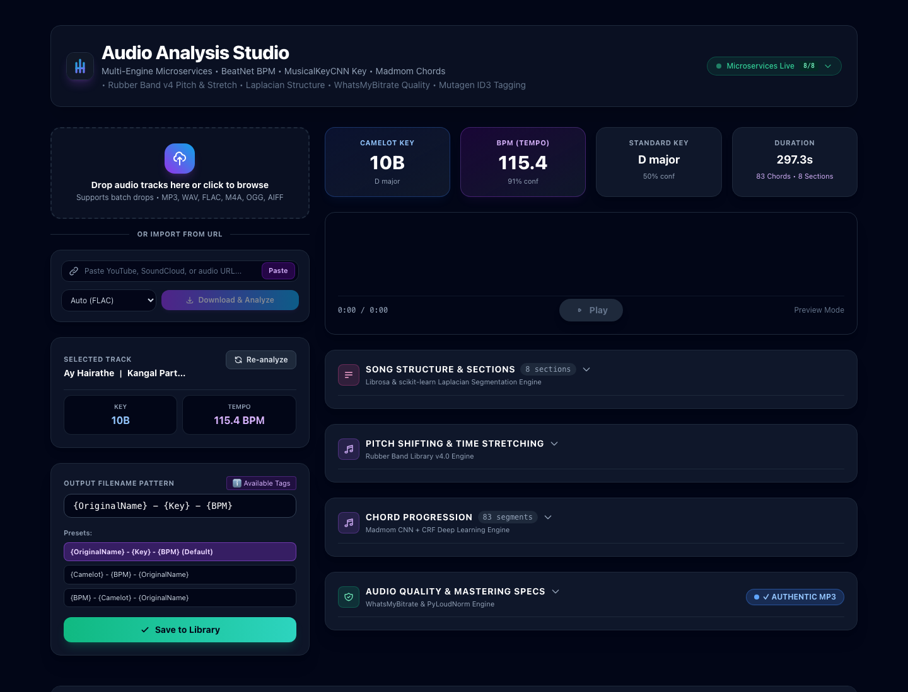

<div align="center">


# Audio Analysis Studio

**AI-Powered Multi-Engine Audio Intelligence • Key, BPM, Chords & Quality Inspection**

[](https://github.com/binuengoor/Audio-Analysis-Studio/actions/workflows/docker-publish.yml)
[](LICENSE)

</div>

A high-performance audio analysis dashboard powered by an asynchronous **multi-engine microservices architecture** and a modern React dark-themed UI. Drop in any audio track, inspect BPM, Camelot Key, Standard Key, interactive chord progression timelines, master loudness (LUFS), frequency cutoffs, fake-lossless transcode verdicts, linear-frequency spectrograms, and automatically embed ID3 metadata tags.



---

## Highlights & Features

- **Multi-Engine Microservices Architecture:**
  - **Tempo & BPM Detection:** [BeatNet](https://github.com/mjhydri/BeatNet) state-of-the-art DBN (Dynamic Bayesian Network) beat and downbeat tracking engine (`bpm-worker:8001`).
  - **Key & Camelot Detection:** [MusicalKeyCNN](https://github.com/danielfriis/musical-key-cnn) deep neural network predicting both Camelot wheel notations (`12A`, `8B`, etc.) and Standard Key (`C# minor`, `F major`, etc.) (`key-worker:8002`).
  - **Chord Progression Recognition:** [Madmom](https://github.com/CPJKU/madmom) CNN + CRF (Conditional Random Field) chord segmentation and harmonic progression modeling (`chord-worker:8003`).
  - **Song Structural Segmentation Engine:** [Librosa](https://librosa.org/) & `scikit-learn` beat-synchronous CQT Chroma + MFCC Laplacian agglomerative segmentation detecting macro song sections (`Intro`, `Verse`, `Chorus`, `Bridge`, `Outro`) (`structure-worker:8005`).
  - **Audio Quality & Bitrate Engine:** "WhatsMyBitrate"-style inspection via `flac-detective`, `pyloudnorm`, `soundfile`, and `mutagen` extracting container properties, integrated LUFS loudness, true peak dBFS, cutoff frequency, and authenticity verdicts (`quality-worker:8004`).
  - **Pitch Shifting & Time Stretching Engine:** [Rubber Band Library v4.0](https://breakfastquay.com/rubberband/) microservice (`stretch-worker:8007`) offering high-fidelity pitch transposition (±12 semitones / cents), tempo time-stretching (0.5x to 2.0x / target BPM), and vocal formant preservation.
  - **Modular Audio-Only URL Downloader Engine:** [yt-dlp](https://github.com/yt-dlp/yt-dlp) + [FFmpeg](https://ffmpeg.org/) microservice (`downloader-worker:8006`) extracting highest-quality FLAC/MP3 streams from YouTube, SoundCloud, Bandcamp, and direct audio links.
  - **Asynchronous Distributed Job Queue:** Redis broker + Celery worker daemon enabling non-blocking multi-file batch drops and live status polling.
  - **API Gateway:** Lightweight, high-throughput FastAPI gateway orchestrating parallel worker requests.

- **Real-Time Microservices Health Status & Topology Inspector:**
  - **Dynamic Status Badge:** Auto-polls `GET /api/health/services` every 30 seconds, showing `Microservices Live (8/8)` in green, `Partial Outage` in amber, or `Services Offline` in red.
  - **Topology Popover:** Interactive popup displaying real-time operational state, port assignment, and round-trip HTTP response latency (in ms) for all 8 microservices and Redis.

- **Uniform Collapsible Analysis Sections (Collapsed by Default):**
  - **Song Structure & Sections:** Macro section pills with timestamp ranges, durations, and seek navigation.
  - **Pitch Shifting & Time Stretching:** Pitch shift slider, tempo multiplier, formant preservation toggle, audio preview, and custom output filename pattern with direct export.
  - **Chord Progression Viewer:** Interactive timeline with click-to-seek playback sync and harmonic flow journey.
  - **Audio Quality & Mastering Specs:** Container codec, bit depth, sample rate, LUFS mastering evaluation, and linear spectrogram cutoff overlay.

- **Automated ID3 Metadata Tagging:**
  - Embedded `TBPM` (BPM tempo) and `TKEY` (Camelot Key / Standard Key) tags are automatically written directly into the file headers using `mutagen` on analysis and export.

- **Flexible Token-Based Renaming:**
  - Standardized filename pattern generator for library downloads and transformed pitch-shifted files (`{OriginalName}`, `{Key}`, `{Camelot}`, `{BPM}`, `{Pitch}`, `{Tempo}`). Preserves musical notation symbols (`#`, etc.).

- **Apple Silicon & Multi-Architecture Native Support:**
  - Fully optimized for ARM64 (Apple Silicon M1/M2/M3/M4) and AMD64 with OpenBLAS hardware acceleration and multi-threaded linear algebra.

---

## Architecture Overview

```
                                      ┌──────────────────────────┐
                                      │   Frontend (React/Vite)  │
                                      │   http://localhost:3000   │
                                      └─────────────┬────────────┘
                                                    │ HTTP / Polling
                                                    ▼
                                      ┌──────────────────────────┐
                                      │   API Gateway (FastAPI)  │
                                      │   http://localhost:8000   │
                                      └──────┬────────────┬──────┘
                                             │            │ Enqueue Tasks / Download URL
                                             │            ▼
                                             │    ┌───────────────┐
                                             │    │     Redis     │
                                             │    │   Port: 6379  │
                                             │    └───────┬───────┘
                                             │            │ Task Queue
                                             │            ▼
                                             │    ┌───────────────┐
                                             │    │ Celery Worker │
                                             │    │  (Async Exec) │
                                             │    └───────┬───────┘
                                             │            │
                                             ▼            ▼  (Multi-Worker Execution)
 ┌─────────────────┬──────────────────┬───────────────────┼───────────────────┬─────────────────┬─────────────────┬─────────────────┐
 │                 │                  │                   │                   │                 │                 │                 │
 ▼                 ▼                  ▼                   ▼                   ▼                 ▼                 ▼                 ▼
┌───────────────┐ ┌────────────────┐ ┌─────────────────┐ ┌─────────────────┐ ┌─────────────────┐ ┌─────────────────┐ ┌─────────────────┐
│  BPM Worker   │ │   Key Worker   │ │  Chord Worker   │ │ Quality Worker  │ │Structure Worker │ │Downloader Worker│ │ Stretch Worker  │
│   (BeatNet)   │ │(MusicalKeyCNN) │ │    (Madmom)     │ │(WhatsMyBitrate) │ │   (Laplacian)   │ │ (yt-dlp/FFmpeg) │ │ (Rubber Band 4) │
│  Port: 8001   │ │   Port: 8002   │ │   Port: 8003    │ │   Port: 8004    │ │   Port: 8005    │ │   Port: 8006    │ │   Port: 8007    │
└───────┬───────┘ └────────┬───────┘ └────────┬────────┘ └────────┬────────┘ └────────┬────────┘ └────────┬────────┘ └────────┬────────┘
        │                  │                  │                   │                   │                   │                   │
        └──────────────────┴──────────────────┴───────────────────┴───────────────────┴───────────────────┴───────────────────┘
                                                  │
                                                  ▼
                                    ┌──────────────────────────┐
                                    │    Shared Audio Volume   │
                                    │  /app/data/shared_audio  │
                                    └──────────────────────────┘
```

---

## Quick Start with Docker Compose

### 1. Clone the Repository
```bash
git clone https://github.com/binuengoor/Audio-Analysis-Studio.git
cd Audio-Analysis-Studio
```

### 2. Start the Stack
```bash
docker compose up -d
```

* **Frontend UI:** [http://localhost:3000](http://localhost:3000)
* **API Gateway:** [http://localhost:8000](http://localhost:8000)
* **BPM Worker:** [http://localhost:8001](http://localhost:8001)
* **Key Worker:** [http://localhost:8002](http://localhost:8002)
* **Chord Worker:** [http://localhost:8003](http://localhost:8003)
* **Quality Worker:** [http://localhost:8004](http://localhost:8004)
* **Structure Worker:** [http://localhost:8005](http://localhost:8005)
* **Downloader Worker:** [http://localhost:8006](http://localhost:8006)
* **Stretch Worker (Rubber Band v4):** [http://localhost:8007](http://localhost:8007)
* **Redis Broker:** `localhost:6379`

To stop all services:
```bash
docker compose down
```

### 3. Prebuilt Container Images (GitHub Container Registry)

All images are continuously built and published to `ghcr.io`:
* `ghcr.io/binuengoor/audio-analysis-studio-gateway:latest`
* `ghcr.io/binuengoor/audio-analysis-studio-frontend:latest`
* `ghcr.io/binuengoor/audio-analysis-studio-bpm-worker:latest`
* `ghcr.io/binuengoor/audio-analysis-studio-key-worker:latest`
* `ghcr.io/binuengoor/audio-analysis-studio-chord-worker:latest`
* `ghcr.io/binuengoor/audio-analysis-studio-structure-worker:latest`
* `ghcr.io/binuengoor/audio-analysis-studio-quality-worker:latest`

To run prebuilt images without local compiling, uncomment the `image: ghcr.io/...` lines in `docker-compose.yml` and run:
```bash
docker compose pull
docker compose up -d
```

---

## Renaming Token Reference

| Token | Inserts | Example |
| :--- | :--- | :--- |
| `{OriginalName}` | Original uploaded filename (without extension) | `My Song` |
| `{Key}` | Standard musical key | `C# minor` / `F major` |
| `{Camelot}` | Camelot wheel key | `12A` / `7B` |
| `{BPM}` | Tempo in beats per minute | `125.0` |

---

## Public REST API (`/api/v1`) & Authentication

Audio Analysis Studio provides a high-throughput, headless REST API for third-party tools, DAWs, mobile apps, and batch analysis scripts.

### Interactive Documentation
Interactive OpenAPI (Swagger) documentation is available at:
* **Swagger UI:** [http://localhost:8000/docs](http://localhost:8000/docs)
* **ReDoc:** [http://localhost:8000/redoc](http://localhost:8000/redoc)

### Interactive Swagger UI & OpenAPI Specs
When the stack is running, explore and execute live API calls via interactive documentation:
* **Interactive Swagger UI:** [http://localhost:8000/docs](http://localhost:8000/docs)
* **ReDoc Documentation:** [http://localhost:8000/redoc](http://localhost:8000/redoc)
* **OpenAPI 3.0 Schema:** [http://localhost:8000/openapi.json](http://localhost:8000/openapi.json)
* **Complete Developer Guide & Examples:** 📖 [**`docs/API.md`**](docs/API.md)

### Authentication (Optional & Cloud-Ready)
* **Local Development (Default):** If `API_KEY` (or `API_KEYS`) is unset, authentication is disabled and all endpoints are open.
* **Production / Cloud Deployment:** Set `API_KEY=your_secret_key` or `API_KEYS=key1,key2` in environment variables.
* **Supported Headers:**
  * `X-API-Key: your_secret_key`
  * `Authorization: Bearer your_secret_key`

### Public REST API Endpoints

#### 1. Audio Stream Downloading (For Downstream Stems & Processing)
| Method | Endpoint | Description |
| :--- | :--- | :--- |
| `POST` | `/api/v1/download/stream` | **Stream Audio Binary:** Downloads highest-quality FLAC/MP3/WAV from URL and streams raw bytes directly to client with metadata headers (`X-Track-Title`, `X-Track-Duration`, etc.). Temp files auto-cleaned. |
| `POST` | `/api/v1/download/info` | **Metadata Inspector:** Returns title, duration, uploader, and thumbnail from URL without downloading audio. |

#### 2. Multi-Engine Analysis (`multipart/form-data` & URL)
| Method | Endpoint | Description |
| :--- | :--- | :--- |
| `POST` | `/api/v1/analyze/basic` | **Fast BPM & Key:** Returns BPM, Standard Key (`C major`), Camelot (`8B`), and duration |
| `POST` | `/api/v1/analyze/key` | **Musical Key Only:** Returns Standard Key, Camelot notation, and confidence score |
| `POST` | `/api/v1/analyze/bpm` | **BPM Tempo Only:** Returns tempo value and confidence score |
| `POST` | `/api/v1/analyze/structure` | **Structural Sections:** Returns timestamped macro sections (`Intro`, `Verse`, `Chorus`) |
| `POST` | `/api/v1/analyze/chords` | **Chord Progression:** Returns harmonic chord sequence with timestamps |
| `POST` | `/api/v1/analyze/quality` | **Audio Quality & Authenticity:** Returns codec, LUFS, peak dBFS, and cutoff |
| `POST` | `/api/v1/analyze/full` | **Comprehensive Analysis:** Runs all 5 engines in parallel on uploaded file |
| `POST` | `/api/v1/analyze/basic/url` | **Fast BPM & Key from URL:** One-step stream download + BPM/Key analysis |
| `POST` | `/api/v1/analyze/url` | **Full Analysis from URL:** One-step stream download + full 5-engine report |

> 💡 For comprehensive code snippets in Python, JavaScript, and cURL for every endpoint, see [**`docs/API.md`**](docs/API.md).

---

## Internal Gateway & Library Endpoints

| Method | Endpoint | Description |
| :--- | :--- | :--- |
| `GET` | `/` | Gateway health check |
| `GET` | `/api/health/services` | Aggregate real-time health & latency of all 8 microservices & Redis |
| `POST` | `/api/upload` | Upload audio file to shared ingestion storage |
| `POST` | `/api/intake/url` | Download audio-only stream from URL (yt-dlp + FFmpeg) & auto-analyze |
| `GET` | `/api/downloader/version` | Get active yt-dlp & FFmpeg versions and cookies status |
| `POST` | `/api/downloader/update` | Live upgrade yt-dlp engine in-container without restart |
| `POST` | `/api/stretch` | Pitch shift and tempo stretch audio via Rubber Band v4.0 |
| `GET` | `/api/stretch/version` | Get active Rubber Band Library version |
| `POST` | `/api/analyze` | Run 5-engine parallel analysis across all microservices |
| `POST` | `/api/analyze/batch` | Enqueue batch analysis tasks to Celery/Redis queue |
| `GET` | `/api/jobs/{job_id}` | Poll Celery job status and get analysis result |
| `POST` | `/api/reanalyze` | Force re-analysis of an existing library audio file |
| `POST` | `/api/queue` | Add a batch list of audio filenames to processing queue |
| `GET` | `/api/status` | Get real-time batch processing progress |
| `POST` | `/api/process` | Copy input → output with tokenized rename and embed ID3 tags |
| `GET` | `/api/library` | Retrieve all library entries and analysis metadata |
| `GET` | `/api/download/input/{filename}` | Download original uploaded audio file |
| `GET` | `/api/download/output/{filename}` | Download processed audio file with embedded ID3 tags |
| `DELETE` | `/api/library/{id}/input` | Delete only the original input file |
| `DELETE` | `/api/library/{id}/output` | Delete only the processed output file |
| `DELETE` | `/api/library/{id}` | Delete complete library entry and associated files |
| `DELETE` | `/api/library` | Clear all library files and database |

---

## Running Automated Tests

```bash
pytest backend/tests/
```

---

## Acknowledgements & Upstream Projects

Audio Analysis Studio is made possible thanks to the extraordinary open-source research and engineering community. Special attribution and gratitude go to the authors and maintainers of the following upstream projects:

- **[BeatNet](https://github.com/mjhydri/BeatNet)** *(Mojtaba Heydari et al.)* – State-of-the-art joint beat and downbeat tracking using Dynamic Bayesian Networks and CRNNs.
- **[MusicalKeyCNN](https://github.com/danielfriis/musical-key-cnn)** *(Daniel Friis et al.)* – Deep Convolutional Neural Network for accurate musical key and Camelot wheel estimation.
- **[Madmom](https://github.com/CPJKU/madmom)** *(Department of Computational Perception, JKU Linz)* – Robust Python audio and music processing library powering CNN + CRF chord recognition.
- **[Rubber Band Library](https://breakfastquay.com/rubberband/)** *(Breakfast Quay / Chris Cannam)* – Gold-standard real-time and offline pitch shifting and time stretching audio engine.
- **[FLAC Detective](https://github.com/aegis-technologies/flac-detective)** *(Aegis Technologies)* – Audio authenticity, frequency cutoff analysis, and fake lossless transcode detection.
- **[PyLoudnorm](https://github.com/csteinmetz1/pyloudnorm)** *(Christian Steinmetz)* – ITU-R BS.1770-4 integrated loudness (LUFS) and true peak calculation.
- **[Librosa](https://librosa.org/)** *(Brian McFee et al.)* – Feature extraction, STFT, and spectrogram generation.
- **[Mutagen](https://github.com/quodlibet/mutagen)** *(Quod Libet team)* – High-fidelity audio metadata tagging and ID3v2 manipulation.
- **[WaveSurfer.js](https://wavesurfer.xyz/)** – Interactive audio waveform rendering and synchronized web playback.
- **[FastAPI](https://fastapi.tiangolo.com/)** *(Sebastián Ramírez)* & **[Uvicorn](https://www.uvicorn.org/)** – High-performance asynchronous REST API framework.

---

## License

This project is licensed under the MIT License.
